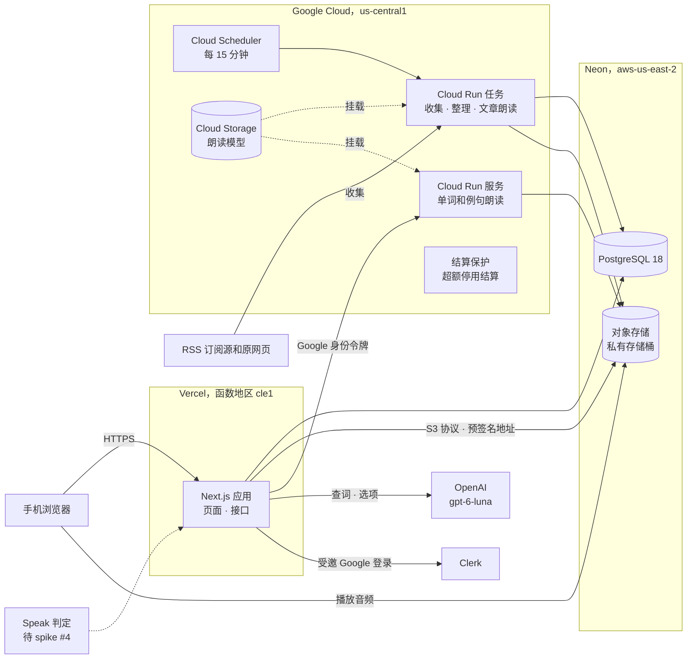

# vexto 架构

vexto 是一个模块化单体：一个 Next.js 应用部署在 Vercel，提供页面和 HTTP 接口；同一份代码另有一个入口，打成一个容器镜像运行在 Google Cloud Run 上，负责收集订阅源和朗读合成。数据和文件都在 Neon。Speak 的判定还在 spike 中（#4）。



## 指标

| 指标     | 内容                                                                                                                            |
| -------- | ------------------------------------------------------------------------------------------------------------------------------- |
| 规模     | 不超过约 10 个账号，同时在线只有几个人；订阅源大约十几个，全部订阅源合计每天约 10 篇文章                                        |
| 可用性   | 尽力而为，不承诺正常运行时间，可以停机维护                                                                                      |
| 一致性   | 每个用户的数据只存在服务端的一个 PostgreSQL 里，任何设备读到的都是最新写入的数据                                                |
| 成本     | 托管用 Vercel Hobby、Neon Free 和 Google Cloud 的免费额度，正常使用时 Google Cloud 每月 0 美元；AI 按用量计费，由项目所有者承担 |
| 维护能力 | 一个人业余维护，组件和运维尽量少                                                                                                |
| 兼容性   | iOS Safari 和 Android Chrome 的最近两个大版本，手机屏幕尺寸，触屏操作                                                           |

不设性能、资源、安全和可访问性指标。

## 组件

| 组件       | 种类                | 技术                                                                                 | 状态                |
| ---------- | ------------------- | ------------------------------------------------------------------------------------ | ------------------- |
| Web 应用   | 网页前端 + 后端服务 | Next.js 16（App Router），TypeScript，Node.js 26 LTS，部署在 Vercel                  | 已搭建              |
| 收集任务   | 定时任务            | 同一份代码的另一个入口，Cloud Run 任务（Job），由 Cloud Scheduler 每 15 分钟启动一次 | #3 接入             |
| 朗读服务   | 后端服务            | 同一个镜像的另一个启动命令，Cloud Run 服务，按需合成单词和例句的读音                 | #3 接入             |
| 结算保护   | 后台函数            | 同一个镜像的第三个启动命令，Cloud Run 服务，收到预算超额的通知就停用项目的结算       | #3 接入             |
| 数据库     | 数据库              | Neon PostgreSQL 18                                                                   | 资源已存在，#3 接入 |
| 对象存储   | 对象存储            | Neon Object Storage，私有存储桶，S3 协议；存文章、单词和例句的音频                   | 资源已存在，#3 接入 |
| 模型存储   | 对象存储            | Google Cloud Storage 存储桶，存固定版本的朗读模型，挂载进 Cloud Run                  | #3 接入             |
| AI         | 第三方服务          | OpenAI `gpt-6-luna`，服务端用官方 SDK 直接调用                                       | #3 接入             |
| 登录       | 第三方服务          | Clerk 应用 `vexto`，受邀 Google 登录，只开 Google 一种登录方式                       | #3 接入             |
| Speak 判定 | 待定                | 待 spike #4                                                                          | 待 spike            |

- 收集任务做完一篇文章的全部工作：读 RSS、需要时抓原网页、整理正文、切分句子、去重、逐句合成朗读、拼成整篇 MP3、上传、写入时间轴，最后把文章标成可读。Web 应用不收集，也不合成文章。
- 朗读服务只做一件事：收到一段文字，合成 MP3，写进 Neon 存储桶，返回对象键、大小、时长和用量。是否需要合成、记录音频和用量由 Web 应用负责。它和收集任务各自运行在不同的实例上，文章合成不会挡住单词读音。
- 朗读用 Supertonic 3 的 F1 声音。模型没有时间戳，所以逐句合成，按每句的长度算出时间轴，再拼成整篇。

## 技术选择和决策点

| 方面         | 决定                                                                                                                                                                                                         |
| ------------ | ------------------------------------------------------------------------------------------------------------------------------------------------------------------------------------------------------------ |
| 框架         | Next.js 16，App Router，Route Handlers 提供接口                                                                                                                                                              |
| 运行时       | Node.js 26 LTS，版本写死在 `.nvmrc` 和 `package.json` 的 `engines` 里；容器镜像用同一个版本                                                                                                                  |
| 语言         | TypeScript 6.0.3（typescript-eslint 还不支持 7）                                                                                                                                                             |
| 包管理器     | pnpm 12，版本写死在 `packageManager` 里                                                                                                                                                                      |
| 构建         | Next.js 自带（Turbopack）；Cloud Run 的镜像用 Docker 构建，`worker.Dockerfile`                                                                                                                               |
| 数据访问     | Drizzle ORM + postgres.js 驱动；接口和外部数据用 Zod 校验                                                                                                                                                    |
| 前端状态     | TanStack Query 管服务端数据，Zustand 管页面状态                                                                                                                                                              |
| 样式         | Tailwind CSS，颜色用语义化变量                                                                                                                                                                               |
| AI           | OpenAI 官方 TypeScript SDK，不经过网关                                                                                                                                                                       |
| 登录         | Clerk 的 Next.js SDK                                                                                                                                                                                         |
| 对象存储访问 | AWS S3 SDK（Neon 的 S3 端点，path-style）                                                                                                                                                                    |
| 订阅源解析   | fast-xml-parser 解析 RSS 和 Atom                                                                                                                                                                             |
| 正文提取     | @mozilla/readability 在 jsdom 上提取正文，不执行网页里的脚本；只在收集任务里运行                                                                                                                             |
| 句子切分     | Node 自带的 `Intl.Segmenter`（英文，按句）                                                                                                                                                                   |
| 朗读合成     | onnxruntime-node 运行 Supertonic 3；推理代码取自 Supertonic 官方仓库的 Node.js 版本（MIT，仓库已归档），复制进项目自己维护，保留原版权声明并标明改动                                                         |
| 朗读模型     | Hugging Face `supertone-oss-archive/supertonic-3`，固定在提交 `aafc6e32416a594460b32413efc49d7fe4ce6d46`，按校验和核对后复制到自己的 Cloud Storage 存储桶                                                    |
| MP3 编码     | 镜像里装的 lame 命令（libmp3lame，单声道，32 kbps）；它是系统程序，不是 npm 依赖                                                                                                                             |
| 调用朗读服务 | Web 应用用 Vercel 的 OIDC 令牌经 Google 身份联合换取朗读服务的身份令牌（google-auth-library、@vercel/oidc）                                                                                                  |
| 观测         | `@vercel/otel`，用 Vercel 免费的 Tracing，采样率要设低；Cloud Run 的日志进 Cloud Logging（免费额度内），日志里不写文章正文和查词内容                                                                         |
| 任务运行器   | Task（`Taskfile.yml`），在 Windows、macOS 和 Linux 上都能直接运行                                                                                                                                            |
| 部署工具     | Vercel CLI，用 `pnpm dlx` 临时运行，版本写死在工作流和 `Taskfile.yml` 里，由 Renovate 更新；不作为项目依赖，因为它自己固定的依赖有高危漏洞，会让 `pnpm audit` 失败。Google Cloud 用 gcloud CLI 和官方 action |

## 各组件的库

库只写名字、用途和许可证，版本只在 `package.json` 和 `pnpm-lock.yaml` 里。用 create-next-app 生成的部分不单独列。每个库由第一个用到它的 issue 安装。Web 应用和 Cloud Run 共用一个 `package.json`。Cloud Run 的镜像只装它的入口用到的运行时库：只给 Web 应用用的库（如 next、react、@clerk/nextjs）列在 `scripts/worker-image.json` 里，构建镜像时从 `package.json` 和 `pnpm-lock.yaml` 里一起去掉，其余的库仍按锁文件的版本安装。

运行时：

| 库                                                | 用途                                         | 许可证     |
| ------------------------------------------------- | -------------------------------------------- | ---------- |
| next、react、react-dom                            | 应用框架和 UI（由 create-next-app 生成）     | MIT        |
| zod                                               | 校验接口输入、AI 输出、外部数据和配置        | MIT        |
| drizzle-orm                                       | 表定义和查询                                 | Apache-2.0 |
| postgres                                          | PostgreSQL 驱动（postgres.js）               | Unlicense  |
| @clerk/nextjs                                     | 登录和会话                                   | MIT        |
| @aws-sdk/client-s3、@aws-sdk/s3-request-presigner | 访问对象存储、生成预签名地址                 | Apache-2.0 |
| @tanstack/react-query                             | 客户端读取和缓存服务端数据                   | MIT        |
| zustand                                           | 页面状态                                     | MIT        |
| openai                                            | 调用 OpenAI                                  | Apache-2.0 |
| @vercel/otel                                      | 链路追踪                                     | MIT        |
| server-only                                       | 防止服务端代码被打进浏览器包                 | MIT        |
| fast-xml-parser                                   | 解析 RSS 和 Atom                             | MIT        |
| @mozilla/readability                              | 从网页里提取正文                             | Apache-2.0 |
| jsdom                                             | 给 Readability 提供 DOM                      | MIT        |
| onnxruntime-node                                  | 运行朗读模型                                 | MIT        |
| google-auth-library                               | 用身份联合换取调用朗读服务的 Google 身份令牌 | Apache-2.0 |
| @vercel/oidc                                      | 在 Vercel 函数里取得 Vercel 的 OIDC 令牌     | Apache-2.0 |

开发和检查：

| 库                                               | 用途                                                               | 许可证       |
| ------------------------------------------------ | ------------------------------------------------------------------ | ------------ |
| typescript                                       | 类型检查                                                           | Apache-2.0   |
| tailwindcss                                      | 样式                                                               | MIT          |
| drizzle-kit                                      | 生成和执行迁移脚本                                                 | MIT          |
| eslint、typescript-eslint、eslint-config-next    | lint；ESLint 停在 9，因为 eslint-config-next 自带的插件还不支持 10 | MIT          |
| prettier                                         | 格式化                                                             | MIT          |
| dependency-cruiser                               | 架构规则                                                           | MIT          |
| jscpd                                            | 重复代码                                                           | MIT          |
| @commitlint/cli、@commitlint/config-conventional | 提交信息格式                                                       | MIT          |
| markdownlint-cli2                                | Markdown 规则                                                      | MIT          |
| lefthook                                         | git hook                                                           | MIT          |
| license-checker-rseidelsohn                      | 依赖许可证                                                         | BSD-3-Clause |
| vitest、@vitest/browser-playwright               | 单元、组件和集成测试                                               | MIT          |
| @testing-library/react                           | 组件测试                                                           | MIT          |
| testcontainers、@testcontainers/postgresql       | 测试里起一次性的数据库和对象存储容器                               | MIT          |
| msw                                              | 在网络层替换第三方服务                                             | MIT          |
| @playwright/test                                 | 端到端测试和截图对比                                               | Apache-2.0   |
| @clerk/testing                                   | 端到端测试里的 Clerk 登录                                          | MIT          |

仓库外的工具：Task、gitleaks、actionlint、zizmor、CodeQL（GitHub 代码扫描）、Vercel CLI、gcloud CLI、Neon CLI（`neonctl`）、Docker；镜像里的 lame（LGPL，只在镜像里作为系统程序调用，镜像存在私有的 Artifact Registry，不对外分发）。

## 代码结构

```text
src/
  app/                    Web 应用的路由和页面入口，只做入口，不放业务逻辑
  worker/                 Cloud Run 的入口：收集任务、朗读服务、结算保护；只做入口
  features/<功能>/
    domain/               纯业务逻辑，不依赖框架、数据库和外部服务
    server/               数据库查询、外部服务调用、接口处理
    ui/                   组件
    index.ts              对其他功能公开的接口
  lib/                    共用的数据库连接、环境变量读取等；跨功能共用的表定义在 lib/db/schema.ts
config/                   随版本发布的配置，例如订阅源
e2e/                      端到端测试
drizzle/                  迁移脚本
scripts/                  检查、测试、迁移和部署用的脚本
worker.Dockerfile         Cloud Run 镜像
```

依赖规则（由 dependency-cruiser 检查，分析到 0 个模块时直接失败）：

- 方向只能是 `app` → `features` → `lib`，`worker` → `features` → `lib`；`app` 和 `worker` 互不引用。
- `domain` 不依赖 `server` 和 `ui`，也不依赖框架和第三方 SDK。
- 一个功能只能通过另一个功能的 `index.ts` 引用它。
- `ui` 不依赖 `server`；浏览器代码不能引用服务端代码和服务端 SDK。
- 只在收集任务和朗读服务里用的库（jsdom、@mozilla/readability、onnxruntime-node）不能被 `app` 引到，免得进 Vercel 的函数包。
- 只给 Web 应用用的库（`scripts/worker-image.json` 里列的）不能被 `worker` 引到，因为 Cloud Run 的镜像里没有它们。
- 不允许循环依赖。

命名：文件和目录全部小写加连字符（如 `word-lookup.ts`、`review-card.tsx`），组件名在代码里用 PascalCase。

每层的测试规则：

| 层       | 测试                                             |
| -------- | ------------------------------------------------ |
| `domain` | 每个导出的函数都有单元测试                       |
| `server` | 用真实 PostgreSQL 的集成测试；外部服务用测试替身 |
| `ui`     | 有交互的组件有组件测试                           |
| `worker` | 入口的集成测试，朗读合成用测试替身               |
| 页面流程 | 端到端测试                                       |

测试文件放在被测文件旁边，端到端测试放在 `e2e/`。文件名决定测试类型：`*.test.ts` 是单元测试，`*.test.tsx` 是组件测试，`*.integration.test.ts`、`*.security.test.ts`、`*.migration.test.ts` 分别是集成、安全和迁移测试。

## 部署目标

| 目标       | 部署到                                                                                                                                                          | 地址                                                        | 用到的资源                                                                                                                                                                                                                                                                                                                                                                                                                                                                                                                                                                                                                                                                                                                      |
| ---------- | --------------------------------------------------------------------------------------------------------------------------------------------------------------- | ----------------------------------------------------------- | ------------------------------------------------------------------------------------------------------------------------------------------------------------------------------------------------------------------------------------------------------------------------------------------------------------------------------------------------------------------------------------------------------------------------------------------------------------------------------------------------------------------------------------------------------------------------------------------------------------------------------------------------------------------------------------------------------------------------------- |
| staging    | Vercel 团队 `juanchaopan1`（ID `team_6WBQUpNIhHEGrjeEWxoFyN62`，Hobby）的项目 `vexto-staging`（ID `prj_NgrKbNMNYpm9D2MyIdjvnNIHxHLS`）；函数地区 cle1；不连 Git | https://vexto-staging.vercel.app                            | Neon 组织 `juanchao` 的项目 `vexto-staging-db`（ID `bold-water-71503400`，aws-us-east-2，PostgreSQL 18，Free），分支 `production`（`br-cool-king-bdzirfp0`），数据库 `neondb`；存储桶 `vexto-staging-audio`（私有）；Clerk 应用 `vexto` 的开发实例                                                                                                                                                                                                                                                                                                                                                                                                                                                                              |
| staging    | Google Cloud 项目 `vexto-staging`（编号 `290764849418`），地区 us-central1，关联项目所有者的结算账户（币种 CAD）                                                | 朗读服务 https://vexto-tts-290764849418.us-central1.run.app | Cloud Run 任务 `vexto-collect`；Cloud Run 服务 `vexto-tts` 和 `vexto-billing-guard`（https://vexto-billing-guard-290764849418.us-central1.run.app）；Cloud Scheduler 任务 `vexto-collect`；Artifact Registry 仓库 `vexto`；模型存储桶 `vexto-staging-models`；Secret Manager 密钥 `DATABASE_URL`、`S3_ACCESS_KEY_ID`、`S3_SECRET_ACCESS_KEY`；Pub/Sub 主题 `vexto-budget` 和推送订阅 `vexto-budget-push`；预算“vexto-staging zero spend”；Workload Identity 池 `github`（提供方 `vexto-repo`）和 `vercel`（提供方 `vexto-staging`）；服务账号 `vexto-deploy`、`vexto-collect`、`vexto-tts`、`vexto-billing-guard`、`vexto-scheduler`、`vexto-budget-push`、`vexto-tts-invoker`（都是 `@vexto-staging.iam.gserviceaccount.com`） |
| production | Vercel 项目 `lingocurrent-production`                                                                                                                           | 待定                                                        | Neon 项目 `lingocurrent-production-db`（ID `misty-art-39773764`，aws-us-east-2），分支 `production`（`br-mute-sea-bdqamwb7`）；存储桶 `lingocurrent-production-audio`（私有）；Google Cloud 项目以后单独建                                                                                                                                                                                                                                                                                                                                                                                                                                                                                                                      |

- staging 在每次合并到 main 且 CI 通过后由 CD 自动部署，部署后跑全部冒烟测试。main 上每个提交各自跑一次 CI，互不取消；部署一次只跑一个，轮到某个提交部署时，如果它已经不是 main 的最新提交，就跳过部署，留给更新的提交。
- 一次部署按这个顺序：迁移数据库 → 构建并推送镜像 → 更新 Cloud Run 任务和服务 → 部署 Vercel → 冒烟测试。Web 应用和 Cloud Run 总是同一个提交，代码和数据库结构的版本一致。
- 每个目标都有一个手动启动的部署任务；生产只部署 main 上通过 CI 的版本标签。手动部署不检查是不是最新提交，可以有意部署旧版本。
- 生产的改名、地址、环境和密钥以后单独搭建，在那之前运行生产部署任务会在检查设置的一步失败。搭建时先建 GitHub 环境 `production` 并限定只允许 main 部署，再放密钥。
- 资源用 `vercel`、`neon`、`gcloud` 和 `gh` 命令行直接创建和修改，不用基础设施即代码。#1 执行过的操作：
  - lingocurrent 仓库的变量 `DEPLOY_ENABLED` 设为 `false`，它不再部署到这些资源；
  - `vercel project rename lingocurrent-staging vexto-staging`；
  - 删掉 `vexto-staging` 的 Development 环境里遗留的 `DATABASE_URL` 和 `DATABASE_URL_UNPOOLED`；
  - `neon projects update bold-water-71503400 --name vexto-staging-db`；
  - 建 GitHub 环境 `staging`（只允许 main 部署），设好它的变量和密钥（见下文）。
- #3 执行过的操作：
  - 在 Neon 分支 `br-cool-king-bdzirfp0` 上建私有存储桶 `vexto-staging-audio`；用 Neon CLI 建这个分支的凭据 `vexto-staging`（权限 `storage:read`、`storage:write`），经管道直接写进 GitHub 环境 `staging` 的两个 S3 密钥；删掉 lingocurrent 的 staging 存储桶 `lingocurrent-staging-audio`；
  - 建 Clerk 应用 `vexto`（`app_3MTvgzTvtdoy9ZLFbtr0jH5wOG9`），它的开发实例（`ins_3MTvh0NtYW3cOCduWE9Q2wFD927`）给 staging 和本机开发用；只开 Google 登录，关掉密码和邮箱验证码登录；Clerk 上的注册是开放的，谁能用由应用查成员表决定；删掉 lingocurrent 的 staging Clerk 应用；
  - 建 Google Cloud 项目 `vexto-staging`（编号 `290764849418`），关联项目所有者的结算账户（币种 CAD），打开这些 API：run、artifactregistry、secretmanager、iamcredentials、sts、cloudbilling、cloudscheduler、pubsub、storage、billingbudgets、iam、cloudresourcemanager；
  - 建 Artifact Registry 仓库 `vexto`，清理策略只保留最新的两个版本；
  - 建模型存储桶 `vexto-staging-models`（统一访问控制，禁止公开访问），把固定版本的朗读模型放进 `supertonic-3/aafc6e32416a594460b32413efc49d7fe4ce6d46/`（约 399 MB）；
  - 建 Secret Manager 密钥 `DATABASE_URL`、`S3_ACCESS_KEY_ID`、`S3_SECRET_ACCESS_KEY`，版本由 CD 部署时写入；
  - 建服务账号（都是 `@vexto-staging.iam.gserviceaccount.com`）并授权：
    - `vexto-deploy`：项目上的 `run.admin`；三个运行身份 `vexto-collect`、`vexto-tts`、`vexto-billing-guard` 上的 `iam.serviceAccountUser`；仓库 `vexto` 上的 `artifactregistry.writer`；三个密钥上的 `secretmanager.secretVersionManager` 和 `secretmanager.secretAccessor`；它自己身上的 `iam.serviceAccountOpenIdTokenCreator`；`vexto-tts` 上的 `run.invoker`；
    - `vexto-collect`：读模型存储桶和三个密钥；
    - `vexto-tts`：读模型存储桶和两个 S3 密钥；
    - `vexto-billing-guard`：项目上的 `billing.projectManager`；
    - `vexto-scheduler`：启动收集任务；
    - `vexto-budget-push`：调用结算保护；
    - `vexto-tts-invoker`：调用朗读服务；
  - 建 Workload Identity 池 `github` 和提供方 `vexto-repo`：只接受仓库 `juanchaopan/vexto`、GitHub 环境 `staging` 的令牌，只有主体 `repo:juanchaopan/vexto:environment:staging` 能扮演 `vexto-deploy`；
  - 建 Workload Identity 池 `vercel` 和提供方 `vexto-staging`：签发方 https://oidc.vercel.com/juanchaopan1，受众 https://vercel.com/juanchaopan1，只有主体 `owner:juanchaopan1:project:vexto-staging:environment:production` 能扮演 `vexto-tts-invoker`；
  - 用 Google 的示例镜像作占位，建 Cloud Run 任务 `vexto-collect` 和服务 `vexto-tts`、`vexto-billing-guard`；第一次真正的部署把占位镜像换成 vexto 的镜像；
  - 建 Cloud Scheduler 任务 `vexto-collect`：`*/15 * * * *`（UTC），以 `vexto-scheduler` 的身份调用 Cloud Run API 的 `jobs.run`；建好时是暂停的，第一次真正的部署之后再恢复；
  - 建 Pub/Sub 主题 `vexto-budget` 和推送订阅 `vexto-budget-push`，以 `vexto-budget-push` 的身份推送到结算保护的 `/budget-notifications`；
  - 建预算“vexto-staging zero spend”：作用于项目 `vexto-staging`，金额 1 加元，阈值 1% 和 100%，通知发到主题 `vexto-budget`；结算保护看到费用大于 0 就停用结算，不等阈值；
  - Vercel 项目 `vexto-staging` 打开 OIDC 联合，签发方模式选 Team；它的 Development 环境写入 Clerk 应用 `vexto` 开发实例的两个值；
  - GitHub 环境 `staging` 设好 #3 的变量和密钥（见下文）。
- Node 版本由 `package.json` 的 `engines`（26.x）决定，函数地区由 `vercel.json` 决定，都不在 Vercel 项目设置里改。

### Google Cloud 的费用

Google Cloud 必须绑定结算账户才能使用。正常使用全部在免费额度以内：

| 资源              | 免费额度                                       | vexto 的用法                                                                      |
| ----------------- | ---------------------------------------------- | --------------------------------------------------------------------------------- |
| Cloud Run 任务    | 每月 24 万 vCPU 秒、45 万 GiB 秒               | 一篇 5 分钟的文章约 680 vCPU 秒；每 15 分钟启动一次，没有到点的订阅源时不加载模型 |
| Cloud Run 服务    | 每月 18 万 vCPU 秒、36 万 GiB 秒、200 万次请求 | 单词和例句的读音、结算保护                                                        |
| 出站流量          | 北美每月 1 GB                                  | 上传到 Neon 的 MP3，每月约 0.4 GB                                                 |
| Cloud Scheduler   | 每个结算账户 3 个任务                          | 1 个                                                                              |
| Cloud Storage     | us-central1 每月 5 GB，同地区读取不收流量费    | 模型约 400 MB                                                                     |
| Artifact Registry | 0.5 GB                                         | 一个不含模型和网页专用包的镜像，压缩后约 120 MB，只保留最近两个版本               |
| Secret Manager    | 6 个活动版本                                   | 3 个密钥，值没变就不写新版本，写了新版本就删掉旧版本                              |

限量和保护：

- 收集任务每次执行用 2 vCPU、2 GiB 内存，最长 60 分钟，失败不自动重试；一次只运行 1 个，并行度为 1。朗读服务最多 1 个实例，没人用时缩到 0；结算保护最多 1 个实例。
- 文章合成按月记账：收集任务记录本月（UTC 日历月）文章合成的运行时间，折算成 vCPU 秒和 GiB 秒，任何一项到 Cloud Run 任务免费额度的 80% 就不再开始合成新文章，已收集的文章等到下个月再合成。订阅源配置的校验按配置里的平均文章长度估算每月用量，超过同一个 80% 就失败（见 0019）。
- 预算：费用一旦大于 0，就给项目所有者发邮件，同时通知结算保护，由它停用项目的结算。停用之后 Cloud Run、Cloud Scheduler 和模型存储桶都会停下来，新文章和单词读音不再生成，Web 应用里已有的内容照常可用。Google 的费用数据有几小时延迟，所以最多可能产生几美分。
- 手动停用结算：Google Cloud 控制台 → 结算（Billing）→ 我的项目（My projects）→ `vexto-staging` 那一行的「⋮」→ 停用结算（Disable billing）。恢复时在同一个页面重新关联结算账户。

## 数据迁移

| 数据                       | 方式                                                                                                                         | 工具                                                                                                         | 在哪里运行                                                                 |
| -------------------------- | ---------------------------------------------------------------------------------------------------------------------------- | ------------------------------------------------------------------------------------------------------------ | -------------------------------------------------------------------------- |
| PostgreSQL                 | 增量迁移：带编号的 SQL 脚本，从当前版本按顺序执行；合并后的脚本不再修改，写错了就加新脚本；第一个脚本由 #3 建                | drizzle-kit 从 Drizzle 表定义生成脚本并执行；迁移用直连地址 `DATABASE_URL_UNPOOLED`，没有时用 `DATABASE_URL` | staging：CD 部署时；生产：手动部署任务里，允许停机；开发机和测试库：建库时 |
| Neon 存储桶里的音频        | 不迁移，也不重建：每个音频记录生成时的声音和编码版本；换了声音或音质以后，只有新生成的音频用新版本，旧音频按存储规则慢慢淘汰 | 无                                                                                                           | 无                                                                         |
| Cloud Storage 里的朗读模型 | 不迁移：每个版本放在以版本命名的目录里，换版本就上传新目录并改配置                                                           | scaffold 用 gcloud 上传并核对校验和                                                                          | 建资源时                                                                   |

一个 issue 同时改几种数据时，各自跑自己的迁移，顺序由那个 issue 提出并确认。还没有迁移脚本时，`task migrate` 直接成功退出。没有重建命令。

## 各组件怎么运行

| 组件               | 开发机                                                                                                          | CI                                                                         |
| ------------------ | --------------------------------------------------------------------------------------------------------------- | -------------------------------------------------------------------------- |
| Next.js 应用       | 本机 Node 直接运行（`next dev`）                                                                                | 运行机上直接构建和启动                                                     |
| 收集任务、朗读服务 | 本机 Node 直接运行；模型由一个 Task 命令按固定版本从 Hugging Face 下载到不提交的目录，核对校验和；lame 装在本机 | 入口的集成测试，朗读合成用测试替身，返回固定的音频夹具；镜像只构建，不推送 |
| PostgreSQL         | 容器（`postgres:18`）                                                                                           | 测试命令用 Testcontainers 起一次性的容器                                   |
| 对象存储           | 容器里的 Adobe S3Mock                                                                                           | 同左，由测试命令起停                                                       |
| OpenAI             | 真实服务，用开发环境自己的密钥（见下文“本机开发”）                                                              | MSW 测试替身                                                               |
| Clerk              | Clerk 应用 `vexto` 的开发实例，和 staging 共用                                                                  | Clerk 官方的测试模式，用 @clerk/testing                                    |
| Cloud Scheduler    | 不运行，需要时手动运行收集任务                                                                                  | 不运行                                                                     |
| Google 身份联合    | 本机的 Web 应用直接调用本机的朗读服务，不带身份令牌                                                             | 测试替身                                                                   |
| Speak 判定         | 待 spike #4                                                                                                     | 待 spike #4                                                                |

S3Mock 不校验预签名地址的签名，所以“过期的预签名地址不能用”这类行为由单元测试检查，真实的存储桶由 staging 的冒烟测试检查。

## 静态检查

| 检查         | 工具                                                                                                                                                                                                                                                                                                                                                                                                    |
| ------------ | ------------------------------------------------------------------------------------------------------------------------------------------------------------------------------------------------------------------------------------------------------------------------------------------------------------------------------------------------------------------------------------------------------- |
| 格式         | Prettier（每行 100 字符，单引号，LF 换行），也覆盖 Markdown、YAML 和 JSON                                                                                                                                                                                                                                                                                                                               |
| Lint         | ESLint + typescript-eslint + eslint-config-next；圈复杂度不超过 10，嵌套不超过 3 层，函数不超过 100 行，禁止 `any`                                                                                                                                                                                                                                                                                      |
| 类型检查     | `next typegen` 加 `tsc --noEmit`                                                                                                                                                                                                                                                                                                                                                                        |
| 编译和构建   | `next build`；另外构建 Cloud Run 的镜像，只构建不推送                                                                                                                                                                                                                                                                                                                                                   |
| 架构规则     | dependency-cruiser                                                                                                                                                                                                                                                                                                                                                                                      |
| 重复代码     | jscpd，阈值 2%，至少 60 个 token、8 行才算重复；忽略 Markdown、JSON、YAML 和测试夹具                                                                                                                                                                                                                                                                                                                    |
| 代码安全扫描 | CodeQL（TypeScript 和 GitHub Actions 工作流）；不开 GitHub 的 CodeQL 默认配置，否则会和这个工作流冲突                                                                                                                                                                                                                                                                                                   |
| 依赖漏洞     | `pnpm audit`，有高危或严重漏洞就失败；打开 Dependabot 漏洞提醒                                                                                                                                                                                                                                                                                                                                          |
| 密钥泄露     | gitleaks；打开 GitHub 密钥扫描和推送保护                                                                                                                                                                                                                                                                                                                                                                |
| 许可证       | 检查运行时依赖（license-checker-rseidelsohn 加 `pnpm licenses list`，后者能看到可选依赖）：允许 MIT、MIT-0、Apache-2.0、BSD-2-Clause、BSD-3-Clause、ISC、0BSD、Unlicense、CC0-1.0、BlueOak-1.0.0；遇到 GPL、AGPL、其他 LGPL 或未知许可就失败。例外只有两项：sharp 的平台包 `@img/sharp-*` 可以是 LGPL-3.0-or-later（动态链接的库，应用自己运行、不分发）；`caniuse-lite` 可以是 CC-BY-4.0（只要求署名） |
| 工作流配置   | actionlint、zizmor                                                                                                                                                                                                                                                                                                                                                                                      |
| 提交信息     | commitlint 检查 Conventional Commits 格式和长度；项目自己的脚本检查提交类型和分支的 issue 类型对应、issue 号、`Step:` 尾行                                                                                                                                                                                                                                                                              |
| 步骤检查     | 项目自己的脚本：按 `Step:` 尾行检查每个提交只改了该步骤允许改的文件，跳过把 main 合进来的提交                                                                                                                                                                                                                                                                                                           |
| PR 标题      | 项目自己的脚本：类型和分支名对应                                                                                                                                                                                                                                                                                                                                                                        |
| 文档格式     | Prettier + markdownlint-cli2，覆盖 `.docs/` 和根目录的 Markdown                                                                                                                                                                                                                                                                                                                                         |
| AI 精简      | 开 PR 前在本机跑 `/simplify`                                                                                                                                                                                                                                                                                                                                                                            |
| AI 评审      | 开 PR 前在本机跑 `/code-review medium`，不在 CI 里跑                                                                                                                                                                                                                                                                                                                                                    |
| AI 安全评审  | 开 PR 前在本机跑 `/security-review`                                                                                                                                                                                                                                                                                                                                                                     |

git hook 由 lefthook 管理。hook 可以被跳过，所以 hook 里的每项检查在 CI 里都会再跑一遍。

## 测试

| 测试   | 工具                                                                                                                              | 真实运行的部分                                                                     | 测试替身                   |
| ------ | --------------------------------------------------------------------------------------------------------------------------------- | ---------------------------------------------------------------------------------- | -------------------------- |
| 单元   | Vitest（Node）                                                                                                                    | 一个函数或类                                                                       | 它依赖的一切               |
| 组件   | Vitest 浏览器模式 + Testing Library                                                                                               | 一个组件或页面                                                                     | 后端接口                   |
| 集成   | Vitest + Testcontainers + MSW                                                                                                     | 从接口或 Cloud Run 入口到真实 PostgreSQL 和 S3Mock；数据库用迁移脚本从空库建起     | 前端、第三方服务、朗读合成 |
| 安全   | 同集成测试                                                                                                                        | 登录、权限、用户数据隔离、恶意输入的用例                                           | 第三方服务、朗读合成       |
| 端到端 | Playwright，手机尺寸的 WebKit 和 Chromium；本机和 CI 都在同一个固定版本的 Playwright Linux 容器里跑，截图基线也只在这个容器里生成 | 整个 Web 应用、数据库和对象存储                                                    | 第三方服务、朗读服务       |
| 冒烟   | 端到端测试里打了 `@smoke` 标签的几个；只改动不了任何东西的还打 `@production-safe`                                                 | 部署好的目标                                                                       | 无                         |
| 迁移   | Vitest + Testcontainers                                                                                                           | 用上一版格式的数据（含空值、最大长度、特殊字符）跑新的迁移脚本；只新建表的脚本不写 | 无                         |

不写合同测试（前后端在同一个仓库，一起部署），不做性能测试（没有性能指标），不加自动安全扫描，不设覆盖率下限。真实的朗读合成只在 staging 上由冒烟测试检查：部署任务用自己的 Google 身份请朗读服务合成一个单词，确认拿回的是能播放的 MP3。

指标和测试的对应：

| 指标或要求                             | 测试                                       |
| -------------------------------------- | ------------------------------------------ |
| 兼容性（iOS Safari、Android Chrome）   | 端到端测试在 WebKit 和 Chromium 上各跑一遍 |
| 只能看到自己的数据，只有受邀的人能登录 | 安全测试                                   |
| 手机屏幕尺寸                           | 组件测试和端到端测试的截图                 |
| 文章合成不超过免费额度                 | 订阅源配置校验和按月记账的单元测试         |

运行时机：

| 时机                     | 跑什么                                                                                                                                                                                                                                     |
| ------------------------ | ------------------------------------------------------------------------------------------------------------------------------------------------------------------------------------------------------------------------------------------ |
| 提交前（只查暂存的文件） | Prettier、ESLint、markdownlint、gitleaks；改了工作流时跑 actionlint 和 zizmor                                                                                                                                                              |
| 写提交信息时             | commitlint、步骤检查                                                                                                                                                                                                                       |
| 推送前                   | 类型检查、受影响的单元测试                                                                                                                                                                                                                 |
| 开 PR 前                 | 架构规则、重复代码；受影响的单元、组件、集成（含安全用例）和端到端测试；改了迁移相关的文件时跑迁移测试；`/simplify`、`/code-review medium`、`/security-review`                                                                             |
| PR CI                    | 格式、lint、文档格式、密钥泄露、工作流配置、提交信息和步骤检查、PR 标题、类型检查、构建、架构规则、重复代码、CodeQL、依赖漏洞、许可证、全部单元、组件、集成和安全测试，两种浏览器的端到端测试，改了迁移相关的文件时的迁移测试，`risk-gate` |
| 合并到 main 后           | 完整再跑一遍 CI，通过后部署 staging                                                                                                                                                                                                        |
| 部署到 staging 后        | 全部冒烟测试                                                                                                                                                                                                                               |
| 发版前                   | CodeQL、依赖漏洞、许可证、两种浏览器的端到端测试、迁移测试                                                                                                                                                                                 |

PR CI 里的每一项都是必过检查。一项检查被路径过滤跳过时，它的任务在工作流内部判断，仍然报告成功。迁移测试由 CI 任务判断要不要跑：`drizzle/`、`*.migration.test.ts`、各功能的表定义、`src/lib/db/schema.ts`、`drizzle.config.ts` 或迁移命令有改动时才跑；`task test-migration` 本身总是跑全部迁移测试。

本机范围：CI 总是跑全部。本机开 PR 前，单元、组件、集成、端到端测试都只跑代理判断受影响的部分。这样有风险：代理漏判的测试要等 CI 才发现失败。

vexto 是公开仓库，GitHub 标准运行机的 CI 分钟不限量。

## 评审标准和风险规则

AI 评审只在本机做：开 PR 前跑 `/code-review medium` 和 `/security-review`，不在 CI 里跑，所以不需要 Claude GitHub App 和 API 密钥。CodeQL 在 PR 上留下的代码扫描意见也算评审意见，合并前要处理。

`REVIEW.md` 的内容：

- **代码结构**：按功能分模块，模块内分 `domain`、`server`、`ui` 三层；业务规则放在 `domain`，路由、页面和 Cloud Run 入口只做入口；每层有规定的测试。
- **代码像一次写成**：注释只说明现在的代码做什么、为什么这样设计，不写修改历史（“改为”“新增”“修复”之类）；不留没用的代码和临时补丁。
- **不写死个人情况**：订阅源、邮箱、名字、地区、模型名、价格这类具体值，都放在配置文件或环境变量里，由代码读取。
- **外部调用不在事务里**：AI、语音合成和对象存储的调用不放在数据库事务里，提交前再检查一次状态。
- **AI 输入输出的安全**：文章内容只当数据，里面的指令一律不执行；AI 返回的结果先用 Zod 校验格式，再检查含义，比如目标词的位置对得上、正确选项恰好一个。
- **密钥不进命令行**：密钥不写进命令行参数、日志和构建环境，只从标准输入、文件或平台的密钥库读取。
- **每个用户只碰自己的数据**：每个查询都按当前用户过滤；访问别人的数据返回 404；每次请求都确认用户仍在允许名单里。
- **评论语言**：评审评论用中文，标明 [Important]、[Nit] 或 [Pre-existing]。

风险规则写在 `.github/risk-rules.txt`。CI 任务 `risk` 检出目标分支，用目标分支上的规则文件、分级脚本和 `.nvmrc` 来分级，PR 里改动的规则文件和分级脚本对自己不起作用。以下情况一律算高风险：目标分支上缺规则文件、分级脚本或 `.nvmrc`；PR 改动的文件达到 3000 个（接口最多只返回 3000 个），或者列出的数目和 PR 的改动文件数对不上。工作流 `risk.yml` 本身按 PR 里的版本运行，改了它的 PR 能改掉这道门槛；这类 PR 改的是 `.github/**`，一定是高风险，审批时要专门检查对门槛的改动。

- 高风险：
  - `.github/**`、`lefthook.yml`、`.claude/**`、`AGENTS.md`、`CLAUDE.md`、`REVIEW.md`、`Taskfile.yml`；
  - 检查工具的配置：`eslint.config.mjs`、`.prettierrc.json`、`.prettierignore`、`.dependency-cruiser.cjs`、`.jscpd.json`、`commitlint.config.mjs`、`.markdownlint-cli2.jsonc`、`.gitleaks.toml`、`tsconfig.json`、`vitest.config.ts`、`playwright.config.ts`；
  - 截图基线 `**/*-snapshots/**`；
  - `**/auth/**`、`drizzle/**`、`**/*.sql`、`**/.env*`、`vercel.json`。
- 低风险：`.docs/**`、`**/*.md`、`**/*.txt`、`LICENSE`。
- 有任何一个文件命中高风险，就是高风险；全部文件都命中低风险，才是低风险；其余都是中风险。高风险优先于低风险。`release/*` 分支的 PR 一律算高风险。

## 依赖更新

- 用 Renovate，通过免费的 Mend 托管 App 运行，配置基于 `config:best-practices`。
  - 只升 Node 的 LTS 大版本。
  - GitHub Actions 固定到提交 SHA，后面注释版本号。
  - npm 包发布满 3 天后才升级。
  - 每周维护锁文件，开启依赖看板。
  - 用正则规则同时更新 Playwright 容器镜像，以及工作流和 `Taskfile.yml` 里写死的工具版本（Task、gitleaks、actionlint、zizmor、Vercel CLI、Neon CLI）。
  - Playwright 的容器镜像和 npm 包放在同一组，任何级别的更新都一起升，保持版本一致。
  - `worker.Dockerfile` 的基础镜像固定到摘要，由 Renovate 更新。
- 每周一开 PR：所有非大版本的升级合并成一个 PR，每个大版本单独一个 PR；安全更新随时开。
- PR 标题：产品运行时用的依赖用 `fix(deps): ...`，开发依赖和 CI action 用 `chore(deps): ...`，不带 issue 号，也不带 `Step:` 尾行。合并成组的 PR 可能是两种类型中的任意一种，都能通过检查。
- Dependabot 的漏洞提醒保持打开，Renovate 据此开安全 PR；不配 Dependabot 的版本更新，避免重复的 PR。
- 依赖更新 PR 由 `/issue next` 处理。
- 朗读模型不由 Renovate 更新：它的仓库已经归档，版本固定在上文的提交。

## 平台设置、App、环境变量和密钥

分支规则（GitHub 规则集 `main`，作用于默认分支）：

- 必须走 PR。
- 必过检查全部通过，并且分支必须和 main 同步。必过检查是：`format-check`、`lint`、`docs-lint`、`typecheck`、`build`、`arch`、`duplication`、`licenses`、`audit`、`secrets-scan`、`workflows-lint`、`test-unit`、`test-component`、`test-integration`、`test-security`、`test-migration`、`test-e2e`、`commits`、`pr-title`、`codeql (javascript-typescript)`、`codeql (actions)`、`risk-gate`，都限定由 GitHub Actions 报告。
- 必须解决所有评审对话。
- 只允许 squash 合并。
- 禁止强推和删除 main。
- 没有旁路用户，项目所有者也不能绕过。
- 人工审批：中、高风险的 PR 需要 `human-reviewed` 标签，而且标签要在当前最新提交推上来之后才加，由 `risk-gate` 按 GitHub 服务器记录的时间检查；有新提交时，CI 任务还会去掉这个标签。来自 fork 的 PR 只拿到只读令牌，打不了标签，`risk` 失败，`risk-gate` 跟着失败。

其他设置：

- 仓库只允许 squash 合并，squash 提交的标题用 PR 标题。
- 远程的 issue 分支合并后永久保留；本地分支合并后删除。
- 打开密钥扫描、推送保护和 Dependabot 漏洞提醒。
- App：只装 Mend Renovate。

Google Cloud 的身份：不用任何长期的服务账号密钥。

- GitHub 的部署任务通过 Workload Identity Federation 登录，提供方只接受本仓库、GitHub 环境 `staging` 的令牌，换成部署用的服务账号，有权推送镜像、更新 Cloud Run 和写 Secret Manager。
- Web 应用用 Vercel 的 OIDC 令牌（Vercel 项目要开启 OIDC 联合），提供方只接受团队 `juanchaopan1` 的项目 `vexto-staging` 的 Production 环境，换成只有 `vexto-tts` 调用权限（Run Invoker）的服务账号。
- 朗读服务和结算保护设成需要认证，只有 Run Invoker 能调用；Cloud Scheduler 和预算通知用各自的服务账号调用。
- 收集任务和朗读服务的运行身份只能读模型存储桶和它们自己的 Secret Manager 密钥；结算保护的运行身份只能停用本项目的结算。

环境变量和密钥按环境存放，每个值只在一个地方修改：

- **staging 和 production**：以 GitHub 环境 `staging`、`production` 为准，这两个环境各自保存该目标的全部变量和密钥，只允许从 main 部署。应用运行在 Vercel 上，只能读 Vercel 项目里的环境变量，所以部署任务在构建之前，把运行时要用的值从 GitHub 环境经标准输入写进该目标 Vercel 项目的 Production 环境：密钥写成 Sensitive，变量写成普通类型；GitHub 环境里没有值的名字跳过；某个值存成了错误的类型（密钥存成了变量，或者反过来）时停止同步。Cloud Run 要用的密钥同样经标准输入写进该目标 Google Cloud 项目的 Secret Manager，值没变就不写新版本，写了新版本就删掉旧版本；变量写成 Cloud Run 的环境变量。Vercel 和 Google Cloud 里的值都只是副本，每次部署都会覆盖。运行时变量的名字和类型以 `scripts/lib/runtime-env.ts` 为准，清单里还写明每个值是 Web 应用用、Cloud Run 用还是都用；部署工作流的同步步骤按名字逐个接收这些值，不接收整个密钥集合，一个单元测试保证工作流里的名字和类型与这份清单完全一致。新加一个运行时值，要同时加进清单和同步步骤。
- **本机开发**：保存在 Vercel 项目 `vexto-staging` 的 Development 环境，用 `task env-pull` 生成不提交的 `.env.local`。拉取哪个项目和团队写在 `scripts/env-pull.json` 里，可以用环境变量覆盖。本机的 `DATABASE_URL` 指向本机的 PostgreSQL 容器，对象存储指向本机的 S3Mock，`TTS_SERVICE_URL` 指向本机的朗读服务。

| 名称                                                     | 用途                             | 类型 | 谁读                         | 值从哪来                                                                                                    | 由谁设置      |
| -------------------------------------------------------- | -------------------------------- | ---- | ---------------------------- | ----------------------------------------------------------------------------------------------------------- | ------------- |
| `VERCEL_TOKEN`                                           | 部署到 Vercel                    | 密钥 | 部署任务                     | 项目所有者在 Vercel 网页上新建，每个目标一个；Vercel 不允许命令行登录的会话创建令牌                         | #1（staging） |
| `VERCEL_ORG_ID`                                          | Vercel 团队                      | 变量 | 部署任务                     | 资源本身：`team_6WBQUpNIhHEGrjeEWxoFyN62`                                                                   | #1（staging） |
| `VERCEL_PROJECT_ID`                                      | 该目标的 Vercel 项目             | 变量 | 部署任务                     | 资源本身：staging 是 `prj_NgrKbNMNYpm9D2MyIdjvnNIHxHLS`                                                     | #1（staging） |
| `APP_URL`                                                | 冒烟测试的地址                   | 变量 | 部署任务                     | 资源本身：staging 是 https://vexto-staging.vercel.app                                                       | #1（staging） |
| `GCP_PROJECT_ID`、`GCP_REGION`                           | 该目标的 Google Cloud 项目和地区 | 变量 | 部署任务                     | 资源本身：staging 是 `vexto-staging`、`us-central1`                                                         | #3（staging） |
| `GCP_DEPLOY_PROVIDER`、`GCP_DEPLOY_SERVICE_ACCOUNT`      | 部署任务登录 Google Cloud        | 变量 | 部署任务                     | 建身份联合时得到：staging 是提供方 `vexto-repo` 和服务账号 `vexto-deploy`                                   | #3（staging） |
| `DATABASE_URL`                                           | 数据库连接（连接池）             | 密钥 | Web 应用、收集任务           | Neon 连接地址，用 Neon CLI 取得                                                                             | #3（staging） |
| `DATABASE_URL_UNPOOLED`                                  | 数据库连接（直连，迁移用）       | 密钥 | 部署任务的迁移               | Neon 连接地址，用 Neon CLI 取得                                                                             | #3（staging） |
| `NEXT_PUBLIC_CLERK_PUBLISHABLE_KEY`                      | Clerk 公开密钥                   | 变量 | Web 应用                     | Clerk 应用 `vexto`：staging 和本机用它的开发实例；生产用哪个实例在搭建生产时决定                            | #3（staging） |
| `CLERK_SECRET_KEY`                                       | Clerk 密钥                       | 密钥 | Web 应用                     | 同上，用 Clerk CLI 取得                                                                                     | #3（staging） |
| `OPENAI_API_KEY`                                         | 调用 OpenAI                      | 密钥 | Web 应用                     | 项目所有者在 OpenAI 建，staging、生产和本机各一个，可以各设消费上限                                         | #3（staging） |
| `S3_ENDPOINT`、`S3_REGION`、`S3_BUCKET`                  | 对象存储位置                     | 变量 | Web 应用、收集任务、朗读服务 | Neon 存储桶：staging 是 `vexto-staging-audio`                                                               | #3（staging） |
| `S3_ACCESS_KEY_ID`、`S3_SECRET_ACCESS_KEY`               | 对象存储凭据                     | 密钥 | Web 应用、收集任务、朗读服务 | Neon 分支凭据（staging 是 `vexto-staging`，权限 `storage:read`、`storage:write`），建资源时用 Neon CLI 生成 | #3（staging） |
| `TTS_SERVICE_URL`                                        | 朗读服务的地址                   | 变量 | Web 应用                     | 资源本身：staging 是 https://vexto-tts-290764849418.us-central1.run.app                                     | #3（staging） |
| `GCP_VERCEL_PROVIDER`、`GCP_TTS_INVOKER_SERVICE_ACCOUNT` | Web 应用经身份联合调用朗读服务   | 变量 | Web 应用                     | 建身份联合时得到：staging 是提供方 `vexto-staging` 和服务账号 `vexto-tts-invoker`                           | #3（staging） |

上表的密钥都存在 GitHub 环境里，Cloud Run 用到的那几个（`DATABASE_URL`、`S3_ACCESS_KEY_ID`、`S3_SECRET_ACCESS_KEY`）在部署时另写一份副本进 Secret Manager。定时触发由 Cloud Scheduler 用 Google 自己的认证启动收集任务，所以没有 `CRON_SECRET`。

Vercel 项目 `vexto-staging` 的 Production 环境里有 Neon 集成接入时自动加的 `DATABASE_URL` 和 `DATABASE_URL_UNPOOLED`，部署时由 GitHub 环境里的值覆盖，以 GitHub 的为准；如果 Vercel 不允许覆盖集成管理的变量，#3 回到这一步重新决定。Development 环境里是 Clerk 应用 `vexto` 开发实例的两个值，供本机开发用。

成员名单：`task member -- add|revoke|list <邮箱> --target <环境>` 修改目标环境数据库里的成员表。数据库连接地址由 Neon CLI（`neonctl`，用 `pnpm dlx` 临时运行，版本写死在 `Taskfile.yml` 里）按配置里写的该目标的 Neon 项目和分支取得，项目所有者事先在本机用它登录一次；地址只在内存里交给脚本，不显示，也不写进文件。不用 GitHub 工作流做这件事，因为公开仓库的运行日志和输入谁都能看，会暴露成员的邮箱。

冒烟测试访问健康检查接口，并用部署任务的 Google 身份请朗读服务合成一个单词，不需要外部账号。

## 待定事项

- Speak 用什么判定：由 spike #4 决定，Speak 复习在 #5 实现。
- 生产环境的搭建：包括改名、地址、GitHub 环境 `production` 和它的密钥、生产的 Google Cloud 项目、生产用的 Clerk 应用（沿用 lingocurrent 现有的 `lingocurrent-production-auth`，还是在 Clerk 应用 `vexto` 里建生产实例），以及 Clerk 生产实例的邮件问题。

Last changed: #3 (2026-11-22)
